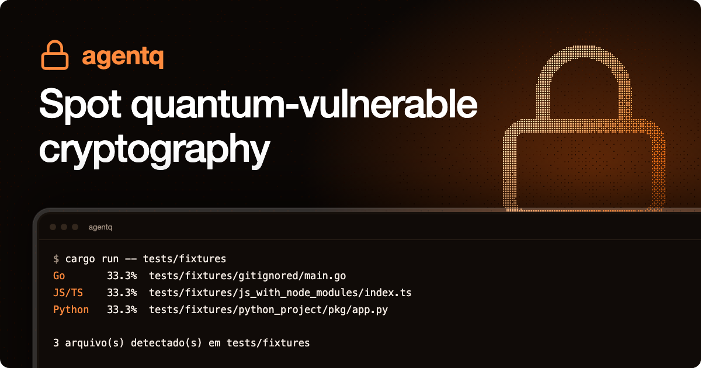
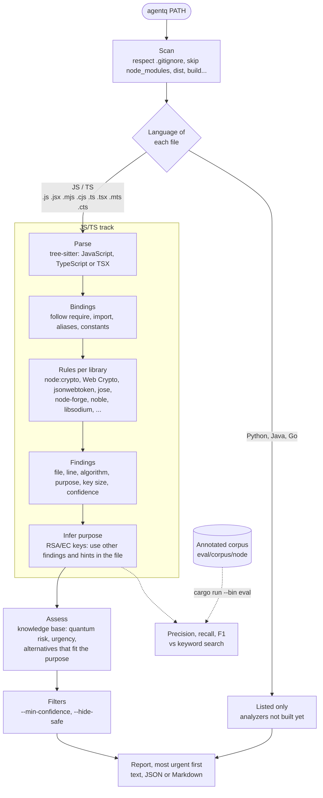

<p align="center">
  
</p>

<p align="center">
  
  
  
  
</p>

# agentq

A proposed tool for analyzing source code, identifying uses of cryptography that may be vulnerable to quantum computing, and recommending post-quantum alternatives suited to the system's context.

> **Status:** this project is in the concept and scope definition stage for an undergraduate final project (TCC, in Brazil). Source scanning and cryptography detection for JavaScript/TypeScript are implemented (see [Current prototype](#current-prototype)); the remaining features described below are planned.

## About the project

**agentq** started with the idea of helping developers understand how their systems use cryptography and how they can prepare for the challenges posed by quantum computing.

The proposal is to analyze another system's source code, locate cryptographic operations, assess their potential vulnerability to quantum attacks, and suggest alternatives with greater resistance to those attacks. Recommendations should take into account the purpose of each operation and the requirements of the system being analyzed.

## Motivation

Sufficiently powerful quantum computers could compromise public-key cryptographic mechanisms in use today. Post-quantum cryptography aims to provide alternatives that resist these attacks and run on conventional computers. This field is the subject of research and standardization efforts by [NIST](https://www.nist.gov/pqc).

Identifying where and how cryptography is used is an important step in planning a migration. agentq aims to support this work through code analysis and recommendations tailored to each use case.

## Goal

Research and develop a tool that helps identify uses of cryptography vulnerable to quantum computing and select appropriate post-quantum alternatives.

### Specific objectives

- Identify cryptographic algorithms, libraries, and calls in source code.
- Locate the files and code sections associated with each finding.
- Analyze the purpose of each operation, such as key establishment or digital signatures.
- Explain the risks associated with the identified mechanisms.
- Recommend alternatives considering security, compatibility, and performance.
- Present the results in a report that developers can understand.

## Proposed workflow

1. **Input:** receive a project's source code for analysis.
2. **Identification:** locate uses of cryptography in the languages and libraries supported by the tool.
3. **Assessment:** map the identified mechanisms to known risks from quantum attacks.
4. **Recommendation:** suggest post-quantum alternatives suited to the purpose of each use and explain the reasoning behind them.
5. **Report:** compile the findings, their locations, associated risks, and recommendations.

Recommendations should support the technical assessment of the team responsible for the system. The suitability of an alternative depends on the context, and the analysis does not guarantee security.

## Current prototype

The prototype runs the whole workflow for **JavaScript and TypeScript (Node.js)** projects. Python, Java, and Go files are listed by the scanner but not analyzed yet.

1. **Scan.** Walks a directory, respects `.gitignore`, skips dependency and build folders (`node_modules`, `vendor`, `target`, `build`, `dist`, `.next`, `coverage`, `.git`), and lists files in the supported languages.
2. **Detect.** Parses each JS/TS file (`.js`, `.jsx`, `.mjs`, `.cjs`, `.ts`, `.tsx`, `.mts`, `.cts`) with [tree-sitter](https://tree-sitter.github.io) and reports cryptographic calls with their location, algorithm, purpose, and key size when it can be read from the code. It follows imports, destructuring, aliases, constants, string concatenation, and template literals, so `const { createHash: h } = require('node:crypto'); h('md5')` is found, while the same words in comments, strings, or shadowing parameters are not.
3. **Infer purpose.** An RSA or EC key pair does not say whether it signs, encrypts, or agrees on secrets. The purpose is inferred from other uses in the same file, and the confidence of such findings drops to `medium`.
4. **Assess.** Each finding is matched against a knowledge base ([`src/knowledge/algorithms.toml`](src/knowledge/algorithms.toml)) that records the quantum attack (Shor or Grover), an urgency, and the NIST post-quantum alternatives that fit the purpose, with libraries that implement them.
5. **Report.** Text, JSON, or Markdown, most urgent first.

### How it works

Each language is a separate track (an analyzer behind the same `Analyzer` trait) that feeds a shared assessment and report stage. Only the JS/TS track exists today.



Recognized APIs: Node.js `crypto`, Web Crypto (`crypto.subtle`), `jsonwebtoken`, `jose`, `node-forge`, `node-rsa`, `elliptic`, `tweetnacl`, `@noble/curves`, `@noble/ed25519`, `@noble/secp256k1`, `crypto-js`, `jsrsasign`, `openpgp`, and `libsodium`. Post-quantum usage (`ml-kem`, `ml-dsa`, `slh-dsa` in `node:crypto` and `@noble/post-quantum`) is reported as safe.

```sh
cargo run -- <directory>                      # defaults to the current directory
cargo run -- <directory> --format markdown    # text (default), json, or markdown
cargo run -- <directory> -o report.json -f json
cargo run -- <directory> --hide-safe --min-confidence medium
cargo run -- <directory> --tui                # browse the findings interactively
```

The interactive interface (`--tui`, built with [ratatui](https://ratatui.rs)) lists the findings most urgent first on the left and shows the selected one on the right: what the code does, why it is a risk, and what to replace it with. Keys: `↑↓`/`jk` select, `PgUp`/`PgDn` scroll the details, `s` hide safe uses, `c` cycle the minimum confidence, `r` scan again, `?` help, `q` quit.

Example, scanning a test fixture:

```text
agentq report for tests/fixtures/node_crypto
knowledge base: 2026-11

Files
JS/TS    100.0%  tests/fixtures/node_crypto/server.js
JS/TS    100.0%  tests/fixtures/node_crypto/session.ts

2 file(s) detected in tests/fixtures/node_crypto

Summary
  4 cryptographic use(s) found
     3 broken
     1 weakened
     3 need urgent attention

Findings (most urgent first)

[HIGH] RSA (encryption) 2048-bit tests/fixtures/node_crypto/server.js:3:35  (confidence: Medium)
    crypto.generateKeyPairSync('rsa', {
    Why: Security rests on integer factoring, which Shor's algorithm solves in polynomial time on a large enough quantum computer. Larger keys do not help. Traffic or data protected this way can be recorded today and decrypted once a quantum computer exists (harvest now, decrypt later).
    Replace with: ML-KEM (CRYSTALS-Kyber)
    Implementations: @noble/post-quantum (JavaScript), liboqs and liboqs-python, OpenSSL 3.5 or later, Bouncy Castle 1.79 or later (Java), crypto/mlkem (Go 1.24 or later)
```

### Evaluation

`cargo run --bin eval` scores the analyzer on an annotated corpus (`eval/corpus/node`, markers like `// @expect md5:hash`) and compares it with a keyword search, the way a developer would use `grep`. Current results, also saved in [`eval/results/node.md`](eval/results/node.md):

| | Precision | Recall | F1 |
| --- | ---: | ---: | ---: |
| agentq | 100.0% | 95.8% | 97.9% |
| keyword search | 65.2% | 62.5% | 63.8% |

The corpus was written by the authors of the analyzer, so these numbers show regressions and the gap to a naive search, not performance on unseen code. Validation on real repositories is still to do.

### Known limitations

- Name resolution is file-local and only considers function parameters for scoping; algorithms chosen at runtime (configuration, values passed through functions) are not reported.
- Calls on values returned by other calls (`key.sign(...)` on a generated key) are not tracked.
- Purpose inference works per file, so unrelated keys in one file can influence each other.
- Only JavaScript and TypeScript are analyzed.

## Next steps

- [ ] Review the literature on post-quantum cryptography and code analysis.
- [ ] Define the research problem and evaluation criteria for the final project.
- [x] Define the languages, libraries, and algorithms within the initial scope (JS/TS first).
- [x] Choose the analysis approach and technologies for the prototype (tree-sitter and a rule-based knowledge base).
- [x] Infer the purpose of each use, assess risk, and recommend post-quantum alternatives.
- [x] Produce the report (text, JSON, Markdown).
- [x] Evaluate the prototype on an annotated synthetic corpus.
- [ ] Evaluate it on real open-source Node repositories, with manual validation.
- [ ] Add analyzers for Python, Java, and Go.
- [ ] Document the results, limitations, and opportunities for future development.

## Team

- Henrico Birochi
- Edgar Camacho Seabra Ribeiro
- Vítor Agostino Braghittoni
- Nicholas Birochi

## Initial references

- [NIST — Post-Quantum Cryptography](https://www.nist.gov/pqc)
- [NCCoE — Migration to Post-Quantum Cryptography](https://www.nccoe.nist.gov/applied-cryptography/migration-to-pqc)
