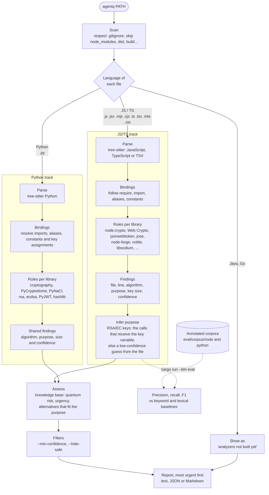

<p align="center">
  
</p>

# agentq

A proposed tool for analyzing source code, identifying uses of cryptography that may be vulnerable to quantum computing, and recommending post-quantum alternatives suited to the system's context.

> **Status:** this prototype implements source scanning, cryptography detection, risk assessment, and reports for JavaScript/TypeScript and Python. Evaluation on real repositories, Java and Go analyzers, and the final thesis remain in progress. The draft, in Portuguese, is in [`docs/tcc.md`](docs/tcc.md).

# Motivation

Sufficiently powerful quantum computers could compromise public-key cryptographic mechanisms in use today. Post-quantum cryptography aims to provide alternatives that resist these attacks and run on conventional computers. This field is the subject of research and standardization efforts by [NIST](https://www.nist.gov/pqc).

## Specific objectives

- Identify cryptographic algorithms, libraries, and calls in source code, in the languages supported by the tool.
- Analyze the purpose of each operation, such as key establishment or digital signatures.
- Explain the risks associated with the identified mechanisms.
- Recommend alternatives considering security, compatibility, and performance.
- Present the results in a report that developers can understand.

## Current prototype

The prototype runs the whole workflow for **JavaScript, TypeScript (Node.js), and Python** projects. Java and Go files are listed by the scanner but not analyzed yet.

1. **Scan.** Walks a directory, respects `.gitignore`, skips dependency and build folders (`node_modules`, `vendor`, `target`, `build`, `dist`, `.next`, `coverage`, `.git`), and lists files in the supported languages.
2. **Detect.** Parses JS/TS and Python with [tree-sitter](https://tree-sitter.github.io) and reports cryptographic calls with their location, algorithm, purpose, and key size when available. The JS/TS analyzer follows imports, destructuring, aliases, constants, string concatenation, and template literals. The Python analyzer resolves imports and aliases and applies rules for `cryptography`, PyCryptodome, PyNaCl, `rsa`, `ecdsa`, PyJWT, and `hashlib`; comments and strings are not treated as calls.
3. **Infer purpose.** An RSA or EC key pair does not say whether it signs, encrypts, or agrees on secrets. Purpose inference follows uses of the same key variable, including direct assignments, tuple unpacking, and `public_key()` aliases in Python. Reassignment invalidates the earlier binding. Confidence drops to `medium` for variable-linked inferences. Purposes include key exchange, encryption, signature, hash, message authentication (HMAC), and key derivation (PBKDF2, HKDF).
4. **Assess.** Each finding is matched against a knowledge base ([`src/knowledge/algorithms.toml`](src/knowledge/algorithms.toml), 28 algorithms) that records what threatens it (Shor, Grover, or a classical weakness such as MD5's collisions), an urgency, and the NIST post-quantum alternatives that fit the purpose, with libraries that implement them. Calls that name an algorithm missing from the knowledge base are listed apart for manual review.
5. **Report.** Text, JSON, or Markdown, most urgent first.

### How it works

Each language is a separate track (an analyzer behind the same `Analyzer` trait) that feeds a shared assessment and report stage. JS/TS and Python analyzers are implemented; Java and Go remain planned.



# Usage
```sh
cargo run -- <directory>                      # defaults to the current directory
cargo run -- <directory> --format markdown    # text (default), json, or markdown
cargo run -- <directory> -o report.json -f json
cargo run -- <directory> --hide-safe --min-confidence medium
cargo run -- --tui                            # pick a project, then browse the findings
cargo run -- <directory> --tui                # browse the findings of a project
cargo run -- samples/node-shop --tui          # try it on the bundled sample shop
```

The interactive interface (`--tui`, built with [ratatui](https://ratatui.rs)) has two pages, switched with `1`, `2` or `Tab`:

- **Overview**: files scanned, how many uses are quantum-vulnerable, weakened or already safe, a chart by urgency, the most used algorithms, the files to review first and the language share. Click an urgency to jump to its first finding.
- **Findings**: the list on the left, most urgent first, and the selected one on the right: what the code does, why it is a risk, and what to replace it with.

Run `cargo run -- --tui` **without a path** to pick the project in a folder browser (folders with a `package.json` or a `.git` are marked); press `b` at any time to choose another one.

Keys: `shift+l` switch the language, `↑↓`/`jk` select, `PgUp`/`PgDn` scroll the details, `s` hide safe uses, `c` cycle the minimum confidence, `r` scan again, `b` browse for another project, `?` help, `q` quit. The mouse works too: click tabs and findings, use the wheel to scroll, and in the browser click a folder once to select it and again to open it.

Example, scanning a test fixture:

```text
agentq report for tests/fixtures/node_crypto
knowledge base: 2026-11

Files
JS/TS    100.0%  tests/fixtures/node_crypto/server.js
JS/TS    100.0%  tests/fixtures/node_crypto/session.ts

2 file(s) detected in tests/fixtures/node_crypto

Summary
  4 cryptographic use(s) found
     3 broken
     1 weakened
     3 need urgent attention

Findings (most urgent first)

[HIGH] RSA (encryption) 2048-bit tests/fixtures/node_crypto/server.js:3:35  (confidence: Medium)
    crypto.generateKeyPairSync('rsa', {
    Why: Security rests on integer factoring, which Shor's algorithm solves in polynomial time on a large enough quantum computer. Larger keys do not help. Traffic or data protected this way can be recorded today and decrypted once a quantum computer exists (harvest now, decrypt later).
    Replace with: ML-KEM (CRYSTALS-Kyber)
    Implementations: @noble/post-quantum (JavaScript), liboqs and liboqs-python, OpenSSL 3.5 or later, Bouncy Castle 1.79 or later (Java), crypto/mlkem (Go 1.24 or later)
```

The analysis runs in the background, so a big folder never freezes the screen: a spinner is shown while it runs, `Esc` cancels, and `r` scans again while the current results stay visible. `Ctrl-C` quits from anywhere.

The interface is structured like a [Bubble Tea](https://github.com/charmbracelet/bubbletea) program: one model (`Tui`), messages (`Msg`: a key, a mouse event, a tick, a finished scan), a single `update` that changes the state and asks for work as commands (`Cmd`), and a `render` that only draws. The runtime runs the commands on threads and feeds their results back as messages, which keeps all the logic testable without a terminal.

### Language

The interface and the reports are available in English and Brazilian Portuguese. The language comes from `--lang en|pt-BR`, or else from the `LC_ALL`, `LC_MESSAGES` or `LANG` environment variables (`pt_BR.UTF-8` gives Portuguese, all empty give English). In the terminal interface, `shift+l` switches it on the fly.

```sh
cargo run -- samples/node-shop --lang pt-BR
cargo run -- samples/node-shop --tui --lang pt-BR
```

JSON output keeps its field names and machine values (`urgency`, `purpose`, ...) in every language and only translates the prose, with a `language` field saying which. The descriptions of each algorithm come from the knowledge base, which has both languages.

### Evaluation

`cargo run --bin eval` scores agentq on the annotated Node corpus (`eval/corpus/node`, markers like `// @expect md5:hash`) and compares it with keyword search. Run the separate Python pilot with `cargo run --bin eval -- eval/corpus/python`; Python markers use `# @expect`. Reports are saved in [`eval/results`](eval/results):

| | Precision | Recall | F1 |
| --- | ---: | ---: | ---: |
| agentq | 100.0% | 95.9% | 97.9% |
| keyword search | 67.4% | 63.3% | 65.3% |

The Python corpus has three synthetic files and two annotated uses. Its report compares the semantic analyzer, keyword search, and the legacy line-based Python scanner kept only as an evaluation baseline:

| Python pilot | Precision | Recall | F1 |
| --- | ---: | ---: | ---: |
| agentq | 100.0% | 100.0% | 100.0% |
| Python lexical baseline | 66.7% | 100.0% | 80.0% |
| keyword search | 40.0% | 100.0% | 57.1% |

These tiny, author-written corpora are regression checks, not evidence of performance on unseen or real-world code. The Python lexical scanner is not part of product analysis. Validation on real repositories is still to do.

agentq is also compared with [qScan](https://github.com/quantakrypto/pqc-tools), a lexical scanner, on each other's corpus ([`eval/external`](eval/external)). On qScan's corpus, written without looking at either tool, agentq finds 9 of 22 JS uses against the 21 qScan publishes; part of the gap is scope (TLS configuration, SSH keys, dependency manifests). On agentq's corpus both find 22 of 23 public-key uses, and agentq gets the algorithm family and the purpose right more often. Sections 6.5 and 6.6 of [`docs/tcc.md`](docs/tcc.md) discuss both results.

### Known limitations

- Name resolution is file-local; algorithms chosen at runtime (configuration, values passed through functions) are not reported.
- Python purpose inference follows direct assignments, tuple unpacking, and `public_key()` aliases, but not function parameters, object fields, arbitrary transformations, or other files.
- JavaScript, TypeScript, and Python are analyzed; Java and Go are not.

## Next steps

- [ ] Review the literature on post-quantum cryptography and code analysis.
- [ ] Define the research problem and evaluation criteria for the final project.
- [x] Define the languages, libraries, and algorithms within the initial scope (JS/TS first).
- [x] Choose the analysis approach and technologies for the prototype (tree-sitter and a rule-based knowledge base).
- [x] Infer the purpose of each use, assess risk, and recommend post-quantum alternatives.
- [x] Produce the report (text, JSON, Markdown).
- [x] Evaluate the prototype on an annotated synthetic corpus.
- [ ] Evaluate it on real open-source Node repositories, with manual validation.
- [ ] Compare it with existing tools on real repositories (first runs against qScan in [`eval/external`](eval/external)).
- [x] Add the Python analyzer to the shared analyzer, assessment, and report pipeline.
- [ ] Add analyzers for Java and Go.
- [ ] Document the results, limitations, and opportunities for future development.

## Team

- Edgar Camacho Seabra Ribeiro
- Henrico Birochi
- Nicholas Birochi
- Vítor Agostino Braghittoni

## Initial references

- [NIST — Post-Quantum Cryptography](https://www.nist.gov/pqc)
- [NCCoE — Migration to Post-Quantum Cryptography](https://www.nccoe.nist.gov/applied-cryptography/migration-to-pqc)
