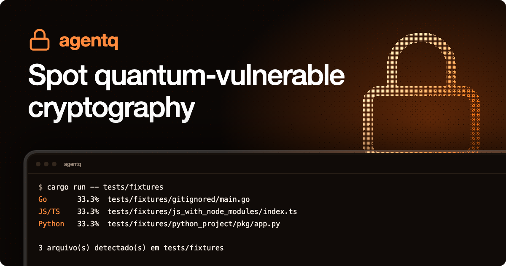
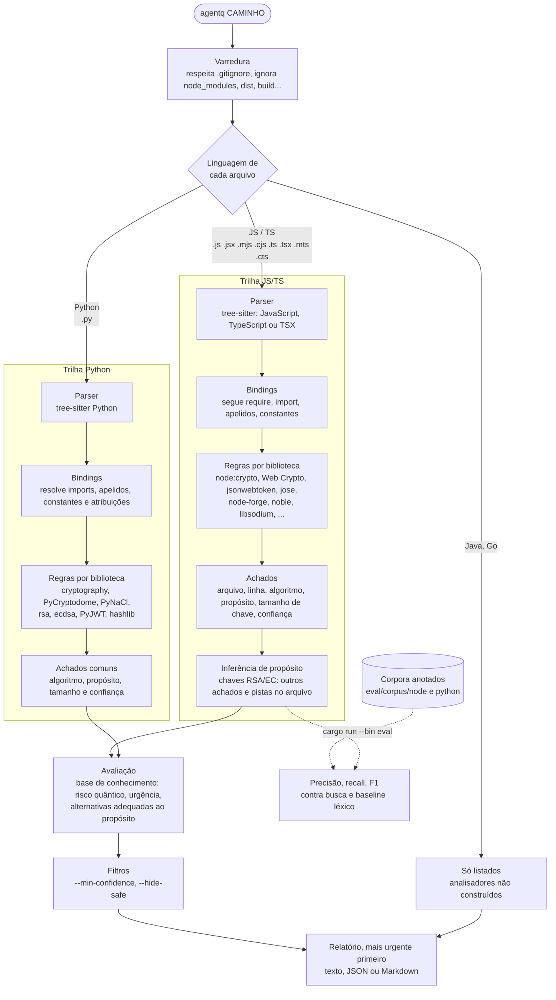

<p align="center">
  
</p>

<p align="center">
  
  
  
  
</p>

# agentq

**Identificação de criptografia vulnerável à computação quântica em código-fonte, com recomendação de alternativas pós-quânticas conforme o propósito de cada uso. A primeira linguagem suportada é JavaScript/TypeScript (Node.js); Python, Java e Go vêm em seguida.**

Trabalho de Conclusão de Curso (em andamento) de Henrico Birochi, Edgar Camacho Seabra Ribeiro, Vítor Agostino Braghittoni e Nicholas Birochi.

> **Como ler este documento.** Este é o rascunho da monografia, no formato de um TCC; a página do projeto, em inglês, é o [README](../README.md). O que já foi medido está escrito como resultado. O que ainda não foi feito está marcado como **pendente**, e nenhum número foi inventado para preencher lacuna. A [seção 8](#8-lacunas-a-fechar-antes-da-banca) lista, por prioridade, o que falta para o trabalho se sustentar diante de uma banca.
>
> Para só usar a ferramenta, vá para [Como usar](#56-como-usar) ou para o [README](../README.md).

## Sumário

1. [Introdução](#1-introdução)
2. [Fundamentação teórica](#2-fundamentação-teórica)
3. [Trabalhos relacionados](#3-trabalhos-relacionados)
4. [Metodologia](#4-metodologia)
5. [A ferramenta](#5-a-ferramenta)
6. [Resultados](#6-resultados)
7. [Discussão e ameaças à validade](#7-discussão-e-ameaças-à-validade)
8. [Lacunas a fechar antes da banca](#8-lacunas-a-fechar-antes-da-banca)
9. [Conclusão parcial e trabalhos futuros](#9-conclusão-parcial-e-trabalhos-futuros)
10. [Referências](#referências)

## Resumo

Computadores quânticos de grande porte quebrariam, com o algoritmo de Shor, a criptografia de chave pública hoje em uso (RSA, Diffie-Hellman e curvas elípticas). Em 2024 o NIST publicou os primeiros padrões pós-quânticos (FIPS 203, 204 e 205), e a migração passou a depender de uma etapa anterior e trabalhosa: saber onde e para que cada sistema usa criptografia. Este trabalho investiga se a análise sintática do código-fonte, com resolução de importações, apelidos e constantes, identifica esses usos melhor que a busca textual, e se é possível inferir o propósito de cada uso (troca de chaves, cifragem ou assinatura) para recomendar o substituto pós-quântico adequado. Foi construído o **agentq**, um analisador estático em Rust sobre tree-sitter, organizado em uma trilha por linguagem que alimenta uma base de conhecimento, uma avaliação de risco e relatórios comuns. A primeira trilha, para JavaScript/TypeScript (Node.js), está implementada; as de Python, Java e Go estão previstas. A base tem 28 algoritmos, e os relatórios saem em texto, JSON, Markdown e interface de terminal. Num corpus sintético de Node.js com 49 usos anotados, a ferramenta obteve precisão de 100% e recall de 95,9%, contra 67,4% e 63,3% de uma busca por palavras-chave. Esse corpus, porém, foi escrito pelos autores depois do analisador; numa sondagem com 26 padrões realistas fora dele, só 6 foram reportados na primeira medição, e 15 depois das correções que ela motivou. No corpus de avaliação publicado pelo qScan, uma ferramenta concorrente de análise léxica, o agentq encontrou 9 de 22 usos em JS, contra 21 de 22 do qScan; parte da diferença é escopo (configuração e dependências) e parte é critério. A validação em repositórios reais, a comparação com ferramentas existentes e a revisão sistemática da literatura ainda estão pendentes e são condição para qualquer conclusão sobre eficácia.

**Palavras-chave:** criptografia pós-quântica; análise estática; inventário criptográfico; migração criptográfica; tree-sitter.

## 1. Introdução

### 1.1 Contexto

A segurança de RSA, Diffie-Hellman e das curvas elípticas depende da dificuldade de fatorar inteiros e de calcular logaritmos discretos. O algoritmo de Shor (1997) resolve os dois problemas em tempo polinomial num computador quântico tolerante a falhas. Esse computador ainda não existe, mas as estimativas de recursos vêm caindo: de cerca de 20 milhões de qubits físicos para fatorar um RSA de 2048 bits em oito horas (Gidney; Ekerå, 2021) para menos de um milhão em menos de uma semana (Gidney, 2025).

O risco não começa no dia em que a máquina existir. Tráfego cifrado gravado hoje pode ser decifrado depois (*harvest now, decrypt later*), o que afeta qualquer dado cujo sigilo precise durar mais que o tempo até esse dia. Mosca (2018) resume a conta: se o tempo que o dado precisa ficar secreto (*x*) somado ao tempo que a migração leva (*y*) for maior que o tempo até um computador quântico relevante (*z*), o dano já está contratado.

Em agosto de 2024 o NIST publicou os padrões ML-KEM (FIPS 203), ML-DSA (FIPS 204) e SLH-DSA (FIPS 205), e o NIST IR 8547 propõe descontinuar os algoritmos vulneráveis ao longo da próxima década. As orientações de migração (NCCoE, SP 1800-38) colocam o **inventário criptográfico** como primeiro passo.

### 1.2 Problema

O inventário é difícil porque a criptografia está espalhada pelo código, escondida atrás de apelidos, constantes e bibliotecas de terceiros. Buscar `RSA` com `grep` devolve comentários e textos de ajuda, e não encontra `const { createHash: h } = require('node:crypto'); h('md5')`. Além disso, saber que há RSA não basta para recomendar um substituto: se a chave cifra, o caminho é ML-KEM; se assina, ML-DSA ou SLH-DSA. O nome do algoritmo não diz qual dos dois.

### 1.3 Pergunta de pesquisa e hipóteses

> **PP.** A análise sintática com resolução de nomes identifica usos de criptografia vulnerável a ataques quânticos com mais precisão e recall que a busca textual e que regras de ferramentas de uso geral? E com que acerto é possível inferir, só pelo código, o propósito de cada uso? A pergunta é respondida primeiro para JavaScript/TypeScript e depois repetida, com o mesmo protocolo, para as demais linguagens suportadas.

- **H1.** A análise sintática com resolução de importações, apelidos e constantes tem precisão e recall maiores que a busca por palavras-chave.
- **H2.** O propósito de um par de chaves RSA ou de curva elíptica pode ser inferido a partir dos outros usos no mesmo arquivo com acerto suficiente para direcionar a recomendação.
- **H3.** Em repositórios reais, a ferramenta atinge precisão que torna o relatório utilizável sem triagem manual de cada achado.

H1 tem evidência preliminar em corpus sintético ([6.1](#61-corpus-sintético)). H2 tem evidência fraca. H3 ainda não foi testada. O limiar de "suficiente" em H2 e H3 precisa ser fixado **antes** de medir ([lacuna 3](#8-lacunas-a-fechar-antes-da-banca)).

### 1.4 Objetivos

**Geral.** Desenvolver e avaliar uma ferramenta que identifique usos de criptografia vulnerável à computação quântica em código-fonte e recomende alternativas pós-quânticas conforme o propósito de cada uso.

**Específicos.**

1. Levantar, na literatura e nas normas, quais algoritmos são afetados por ataques quânticos e quais são os substitutos padronizados.
2. Identificar chamadas criptográficas em JavaScript/TypeScript e, em seguida, em Python, Java e Go, com arquivo, linha, algoritmo e tamanho de chave.
3. Inferir o propósito de cada uso.
4. Classificar o risco e a urgência de cada achado e recomendar alternativas.
5. Apresentar os resultados em relatório compreensível para desenvolvedores.
6. Avaliar precisão, recall e acerto de propósito em corpus anotado e em repositórios reais, comparando com busca textual e com ferramentas existentes.

### 1.5 Delimitação

O trabalho trata de **código-fonte de aplicações**. A implementação começou por JavaScript/TypeScript (Node.js) e agora inclui Python; Java e Go continuam planejados, embora suas gramáticas já estejam ligadas ao parser. Ficam fora: configuração de TLS e infraestrutura de rede, certificados e chaves em arquivo, dependências transitivas (`node_modules` é ignorado), binários, e os requisitos de governança levantados nas histórias de usuário (visibilidade centralizada, conformidade, rastreabilidade de decisões e priorização por criticidade, US01 a US04). Só a US05, do desenvolvedor, é atendida.

A ferramenta também não é um detector de mau uso clássico de criptografia (IV fixo, modo ECB, senha com hash rápido). Esse é outro problema, com literatura própria ([seção 3](#3-trabalhos-relacionados)).

### 1.6 Contribuições pretendidas

- Um analisador de código aberto com núcleo comum (base de conhecimento, inferência de propósito, avaliação e relatório) e trilhas por linguagem, inicialmente JavaScript/TypeScript e Python.
- Um mecanismo de inferência de propósito que liga o achado à recomendação.
- Um corpus anotado e um harness de avaliação reprodutível (`cargo run --bin eval`).

A terceira só vale como contribuição depois de o corpus ter anotação independente. A primeira precisa ser confrontada com o qScan, que já cobre JavaScript com mais amplitude, e, a cada linguagem nova, com as ferramentas que já a cobrem ([seção 3.3](#33-posicionamento)).

## 2. Fundamentação teórica

> Esta seção é um roteiro com o conteúdo mínimo de cada tópico. O texto corrido, com as fontes primárias lidas, é o trabalho pendente de maior peso.

### 2.1 Criptografia de chave pública e seus problemas difíceis

RSA apoia-se na fatoração de inteiros; Diffie-Hellman e DSA, no logaritmo discreto em corpos finitos; ECDH, ECDSA, X25519 e Ed25519, no logaritmo discreto em curvas elípticas. Explicar os três usos (estabelecimento de chaves, cifragem e assinatura), porque a recomendação depende deles.

### 2.2 Algoritmo de Shor

Reduz fatoração e logaritmo discreto à busca de período, resolvida com a transformada de Fourier quântica (Shor, 1997). Aumentar a chave não resolve, porque o custo do ataque cresce polinomialmente. Apresentar as estimativas de recursos (Gidney; Ekerå, 2021; Gidney, 2025; Roetteler et al., 2017, para curvas elípticas) e deixar claro que são estimativas, não ataques demonstrados.

Cuidados de redação que uma banca cobra: não se fatoram "números primos" (fatora-se o produto de dois primos); um computador quântico não "testa todos os estados ao mesmo tempo"; e nenhuma fonte séria fala em quebrar RSA "em minutos".

### 2.3 Algoritmo de Grover e primitivas simétricas

Grover (1996) dá ganho quadrático na busca exaustiva: uma chave de *n* bits cai para cerca de 2^(n/2) avaliações. Na prática o ataque paraleliza mal e exige circuitos profundos (Grassl et al., 2016), e por isso o NIST trata o AES-128 como categoria de segurança 1, aceitável, enquanto o CNSA 2.0 exige AES-256. Para colisões em funções de hash, a vantagem quântica é contestada quando se contam os custos reais (Bernstein, 2009).

Ponto a deixar explícito no texto: MD5, SHA-1 e 3DES são problemas **clássicos**. O computador quântico não é o motivo para trocá-los.

### 2.4 "Colher agora, decifrar depois" e a urgência

A desigualdade de Mosca (2018) e a diferença entre confidencialidade (afetada retroativamente) e autenticidade (afetada só quando o ataque for possível). É essa diferença que justifica o modelo de urgência da [seção 5.4](#54-avaliação-e-urgência).

### 2.5 Criptografia pós-quântica padronizada

Processo do NIST (seleção em 2022, padrões em 2024): ML-KEM, baseado em reticulados (Module-LWE); ML-DSA, também em reticulados; SLH-DSA, baseado em hash. FN-DSA (Falcon, FIPS 206) e HQC (selecionado em 2025 como KEM reserva, NIST IR 8545) ainda estão em padronização; conferir a situação na data da entrega. Discutir custos (tamanho de chaves e assinaturas) e esquemas híbridos.

### 2.6 Migração, cripto-agilidade e inventário

Fases da migração e a falta de consenso sobre elas (Näther et al., 2024); cripto-agilidade (Ott et al., 2019); o CBOM do CycloneDX como formato padrão de inventário.

### 2.7 Análise estática

Diferença entre busca textual, casamento de padrões sobre a árvore sintática (o que o agentq faz), análise de fluxo de dados intraprocedural e interprocedural, e análise de contaminação (*taint*). Situar o agentq com franqueza: árvore sintática com resolução de nomes local ao arquivo, sem fluxo de dados. Falsos positivos como fator de abandono de ferramentas (Johnson et al., 2013; Sadowski et al., 2018).

## 3. Trabalhos relacionados

> **Pendente:** revisão sistemática com protocolo (bases, termos de busca, critérios de inclusão). O que segue é um levantamento inicial. A coluna "Fonte" diz o que foi de fato lido. O qScan foi executado sobre o corpus e a sondagem do agentq, e o agentq sobre o corpus do qScan ([6.5](#65-corpus-independente-do-qscan) e [6.6](#66-o-qscan-no-corpus-e-na-sondagem-do-agentq)); as demais ferramentas não foram executadas.

### 3.1 Scanners de criptografia vulnerável a ataques quânticos

| Ferramenta | Linguagens | Técnica declarada | Situação em JS/TS | Propósito do uso | Avaliação publicada | Fonte |
| --- | --- | --- | --- | --- | --- | --- |
| **agentq** (este trabalho) | JS/TS; Python, Java e Go previstos | Árvore sintática com resolução de nomes local ao arquivo | Sim, 16 bibliotecas | Inferido pela variável da chave ou pelo arquivo | Corpus sintético próprio | — |
| [qScan](https://github.com/quantakrypto/pqc-tools) (Dandelion Labs) | 14, entre elas JS/TS, mais configuração, chaves SSH, PEM, dependências e IaC | Léxica: expressões regulares sobre o texto, com tratamento de alguns apelidos de import | Sim | Fixo por chamada: chave RSA vira KEM e chave EC vira ECDH, para ficar no pior caso | Recall 0,847 num corpus de 8 linguagens escrito sem olhar os detectores (0,955 em JS); auditoria manual em 4 repositórios reais | Código-fonte e `docs/validation/` do repositório (commit `6a81b55`) |
| [pqcheck](https://github.com/Rafael-Ryu/pqcheck) | Python e Go | AST em Python; `go/types` e tree-sitter em Go; sem fluxo de dados | Só o `package-lock.json` | Não: "a symbol match carries no intent" | Recall 0,989 e precisão 0,99 em 6 repositórios separados | README no PyPI (v0.1.0, pré-alfa) |
| [CBOMkit / sonar-cryptography](https://github.com/IBM/sonar-cryptography) (IBM, depois PQCA) | Java, Python, Go; C# em desenvolvimento | Regras sobre o SonarQube | **Não** | Parcial (`cryptoFunctions` no CBOM) | Nenhuma citada | README do repositório |
| CodeQL, consultas experimentais `quantum` | Java | Consultas sobre modelo de fluxo de dados | Não; um executor de terceiros para JS está em beta fechado | — | — | Resultados de busca; repositório não conferido |
| QuantumShield, pqaudit | — | — | — | — | — | **Não examinados** (páginas não carregaram) |

Quatro observações saem daqui.

1. **Cada linguagem tem concorrentes diferentes.** Em JS/TS, o qScan. Em Python e Go, o pqcheck e o CBOMkit. Em Java, o CBOMkit e as consultas experimentais do CodeQL.
2. **Em JS/TS, o concorrente direto é o qScan, e ele é maduro.** Cobre mais linguagens e também configuração, chaves SSH, PEM, dependências e infraestrutura como código; gera CBOM, SARIF e OpenVEX; verifica prazos (CNSA 2.0, NIST IR 8547); e tem triagem opcional com LLM. Publica dois benchmarks com metodologia explícita e a lista de falsos negativos: um corpus ajustado (precisão e recall 1,0) e um corpus de recall escrito "sem olhar os detectores" (0,847 no geral, 0,955 em JS), além de uma auditoria manual em quatro repositórios reais.
3. **A detecção do qScan é léxica, e ele mesmo mede onde isso para.** No corpus de recall, os casos com apelidos e com nomes de algoritmo montados em tempo de execução ficam em 0,47; a documentação chama isso de "teto léxico" e diz que passar dele exigiria análise de fluxo de dados.
4. **Nenhum scanner examinado infere o propósito a partir do código.** O qScan classifica cada chamada de forma fixa e conservadora: um par de chaves EC é sempre reportado como ECDH, e um par RSA sempre como KEM, mesmo quando o código só assina. A documentação dele registra isso como erro de classificação conhecido. O pqcheck diz explicitamente que não infere.

O pqcheck também publica avaliação (recall 0,989 e precisão 0,99 em 6 repositórios separados), mas não cobre JavaScript. O desenho dele e o do qScan são bons modelos para este trabalho.

### 3.2 Detecção de mau uso de criptografia

| Trabalho | O que faz | Relação com o agentq |
| --- | --- | --- |
| CryptoLint (Egele et al., 2013) | Mau uso de APIs criptográficas em apps Android | Origem da linha de pesquisa |
| CogniCrypt / CrySL (Krüger et al., 2017; 2018) | Regras formais de uso correto de APIs Java | Análise de fluxo de dados, mais forte que a do agentq |
| CryptoGuard (Rahaman et al., 2019) | Fatiamento de programa em Java | Referência de precisão em projetos grandes |
| LICMA (Wickert et al., 2021) | Mau uso de criptografia em Python | Linguagens dinâmicas exigem cuidado próprio |
| MASC (Ami et al., 2022) | Avalia detectores por mutação | Método aplicável para medir as falhas do agentq |
| Zhang et al. (2022) | Compara detectores de Java com a opinião de desenvolvedores | Modelo de avaliação em código real |
| CryptoAPI-Bench (Afrose et al., 2019) | Benchmark de mau uso em Java | Modelo de corpus com casos básicos e avançados |
| **JScamd** (Jia et al., 2026) | Análise de contaminação com regras geradas com auxílio de LLM, em JavaScript | O trabalho mais próximo no ecossistema; ver abaixo |
| Semgrep, njsscan, regras de ESLint | Regras para `createHash('md5')` e semelhantes em Node | Baseline de uso geral; só fraquezas clássicas |

**JScamd** (USENIX Security 2026; lidas as páginas 1 a 4) define 16 restrições de segurança para Node `crypto`, Web Crypto, CryptoJS e SJCL: algoritmos inseguros, modo ECB, IV fixo, chave e sal constantes, poucas iterações em derivação de chaves, `Math.random`, TLS fraco e cookies. Avaliou 322 projetos, achou 1.059 maus usos com precisão de 97,78% e comparou com Semgrep, njsscan e CodeQL. O artigo descreve três dificuldades do JavaScript: apelidos de função (`const cipher = crypto.createCipheriv`), o padrão de objeto de opções e importação dinâmica. O agentq resolve a primeira e a segunda quando os valores são literais ou constantes, e não trata a terceira.

O JScamd **não trata de ameaça quântica**: nenhuma das 16 restrições fala de RSA, curvas elípticas ou substitutos pós-quânticos. Os dois trabalhos são complementares, e o conjunto de 322 projetos do JScamd (o artigo tem selo de artefato disponível) é um candidato natural a base da avaliação em repositórios reais.

### 3.3 Posicionamento

"Primeira ferramenta que encontra criptografia vulnerável no código" não se sustenta em nenhuma das quatro linguagens. E, em cobertura, o agentq perde para o qScan: no corpus independente dele, o agentq encontrou 9 de 22 usos em JS, contra 21 de 22 do qScan ([6.5](#65-corpus-independente-do-qscan)). Parte da diferença é escopo (configuração TLS, chaves SSH e dependências, que o agentq não lê) e parte é estratégia: o qScan reporta qualquer menção a um nome de algoritmo, como `"RSA-OAEP"` numa constante, e o agentq só reporta chamadas a APIs criptográficas.

O que diferencia o agentq, pelo que foi examinado, são três coisas, e todas ainda precisam ser demonstradas com dados:

1. **Propósito inferido do código, e recomendação de acordo.** Onde o qScan diz "chave EC: ECDH ou ECDSA, use X25519MLKEM768 ou ML-DSA", o agentq tenta dizer qual dos dois, pela chamada que recebe a chave. A pergunta mensurável é: em código real, com que frequência a classificação fixa erra o propósito, e com que frequência o agentq acerta?
2. **Análise sintática com resolução de nomes, contra análise léxica.** É exatamente onde o qScan mede o próprio teto: apelidos e nomes montados com constantes, concatenação e templates (0,47 de recall). O agentq resolve parte disso por construção e ignora comentários e strings sem regras especiais. A pergunta mensurável é: nos casos difíceis, quanto o agentq recupera, e quantos falsos positivos o qScan produz em código real que o agentq não produz?
3. **Um núcleo comum entre linguagens**, onde cada trilha só fornece as evidências e herda inferência de propósito, avaliação e relatório.

A formulação recomendada para o TCC passa a ser uma comparação entre **duas abordagens**, e não entre duas ferramentas:

> **Análise léxica ampla (qScan) contra análise sintática com inferência de propósito (agentq): onde cada uma acerta e erra ao inventariar criptografia vulnerável, e quanto a inferência de propósito muda a recomendação de migração?**

Essa pergunta vale qualquer que seja o resultado. A hipótese esperada é que o léxico ganhe em cobertura e o sintático ganhe em precisão, nos casos difíceis e no propósito, mas isso precisa sair dos dados.

**Estratégia recomendada para as linguagens.** Mais linguagens dão mais alcance, mas cada uma pede regras, corpus, anotação e comparação próprios, e uma trilha rasa vira o ponto fraco da banca. A sugestão é:

1. **JavaScript/TypeScript completa**, com avaliação em repositórios reais e comparação com qScan e Semgrep. É o caso principal.
2. **Python como segunda trilha**, porque o analisador já começou e porque qScan, pqcheck e CBOMkit cobrem Python, todos com alguma avaliação publicada.
3. **Java e Go** só se houver tempo para avaliá-las com o mesmo rigor; senão, ficam como trabalho futuro com a arquitetura pronta para recebê-las.

Uma trilha por integrante do grupo é uma divisão natural, e resolve também o desequilíbrio de autoria do histórico do repositório. Para isso funcionar, o protocolo de avaliação ([4.3](#43-protocolo-de-avaliação)) e o formato do corpus precisam ser os mesmos em todas.

## 4. Metodologia

### 4.1 Tipo de pesquisa

Pesquisa aplicada, no formato de *Design Science Research* (Hevner et al., 2004): identifica-se um problema, constrói-se um artefato e avalia-se o artefato com rigor. A avaliação é quantitativa (precisão, recall, F1, acerto de propósito) com análise qualitativa dos erros.

### 4.2 Etapas

| Etapa | Situação |
| --- | --- |
| Revisão de literatura | **Pendente** |
| Levantamento de requisitos (histórias de usuário) | Feito; só a US05 entrou no escopo |
| Base de conhecimento de algoritmos | Feito (28 algoritmos) |
| Detecção em JS/TS | Feito (16 bibliotecas) |
| Detecção em Python | Implementada no núcleo comum; avaliação sintética inicial |
| Detecção em Java e Go | **Pendente** (gramáticas ligadas ao parser) |
| Inferência de propósito | Feito, por variável e, na falta dela, por arquivo |
| Avaliação e recomendação | Feito |
| Relatórios e interface de terminal | Feito |
| Avaliação em corpus sintético | Feito, com as ressalvas de [7](#7-discussão-e-ameaças-à-validade) |
| Avaliação em repositórios reais | **Pendente** |
| Comparação com qScan e Semgrep | **Pendente** |
| Redação da monografia | **Pendente** |

### 4.3 Protocolo de avaliação

**Métricas.** Um uso é a tripla (arquivo, linha, algoritmo). Precisão = VP / (VP + FP); recall = VP / (VP + FN); F1 é a média harmônica. O acerto de propósito é calculado sobre os usos localizados corretamente.

**Corpus sintético** (`eval/corpus/node`). Doze arquivos com marcadores `// @expect md5:hash`. Linhas sem marcador não devem gerar achado. Serve para detectar regressão, não para estimar desempenho.

**Piloto Python** (`eval/corpus/python`). Três arquivos e dois usos anotados com `# @expect`; compara o analisador sintático, a busca por palavras e o scanner léxico simples do PR antigo. É apenas um teste do protocolo e da integração, não uma estimativa de desempenho.

**Sondagem fora do corpus** (`eval/probe/node`). Padrões realistas escritos sem olhar as regras da ferramenta, para estimar o que o corpus não mostra.

**Repositórios reais (pendente).** Protocolo proposto:

O protocolo é o mesmo para todas as linguagens; muda só a amostra e os baselines.

1. Fixar os critérios de seleção antes de olhar os resultados: 15 a 20 repositórios de código aberto por linguagem, com popularidade mínima, atividade recente e domínios variados (autenticação, pagamentos, mensageria, carteiras, servidores web). Para JS/TS, uma opção é sortear do conjunto de 322 projetos do JScamd. Registrar o commit de cada um.
2. Separar os repositórios em um conjunto de ajuste, que pode ser usado para corrigir a ferramenta, e um conjunto de teste, que só é analisado uma vez, no fim.
3. **Precisão:** conferir manualmente todos os achados, ou uma amostra aleatória por repositório quando forem muitos.
4. **Recall:** não há gabarito, então estima-se de duas formas: revisão manual completa de uma amostra aleatória de arquivos que importam bibliotecas criptográficas, e a união dos achados de todas as ferramentas comparadas como gabarito aproximado.
5. **Anotação:** dois anotadores independentes, com concordância medida por kappa de Cohen e divergências resolvidas por um terceiro. O grupo tem quatro pessoas; quem escreveu as regras não deve ser o único a anotar.
6. **Baselines:** busca por palavras-chave e regras de criptografia do Semgrep em todas as linguagens, mais as ferramentas específicas de cada uma:

   | Linguagem | Baselines específicos |
   | --- | --- |
   | JS/TS | qScan |
   | Python | pqcheck, CBOMkit, qScan |
   | Java | CBOMkit, consultas `quantum` do CodeQL, qScan |
   | Go | pqcheck, CBOMkit, qScan |

   Como qScan e pqcheck são pacotes de terceiros pouco conhecidos, rodar em contêiner ou máquina descartável.
7. **Propósito:** medir o acerto em três configurações (sem inferência, só por arquivo, por variável) para mostrar quanto cada etapa contribui. Os níveis de confiança do relatório já separam as duas últimas.
8. Reportar intervalos de confiança e os erros por categoria, não só os totais.

## 5. A ferramenta

### 5.1 Arquitetura

Cada linguagem é uma trilha separada (um analisador atrás do mesmo trait `Analyzer`) que alimenta uma etapa comum de avaliação e relatório. As trilhas JS/TS e Python estão implementadas; Java e Go ainda não.



### 5.2 Detecção

Cada arquivo é analisado com [tree-sitter](https://tree-sitter.github.io). O componente central, `Bindings`, liga cada nome ao módulo de origem, seguindo `require`, `import`, `import()`, desestruturação e apelidos. Um avaliador de valores lê argumentos literais, constantes, concatenação, templates e propriedades de objetos constantes. As regras ficam em Rust, uma por biblioteca.

Bibliotecas reconhecidas: `crypto` do Node.js, Web Crypto (`crypto.subtle`), `jsonwebtoken`, `jose`, `node-forge`, `node-rsa`, `elliptic`, `tweetnacl`, `@noble/curves`, `@noble/ed25519`, `@noble/secp256k1`, `crypto-js`, `jsrsasign`, `openpgp`, `libsodium` e o plugin `jwt` do Better Auth. Usos pós-quânticos (`ml-kem`, `ml-dsa`, `slh-dsa` em `node:crypto` e `@noble/post-quantum`) são reportados como seguros.

Em Python, a trilha resolve importações e apelidos antes de aplicar regras para `cryptography`, PyCryptodome, PyNaCl, `rsa`, `ecdsa`, PyJWT e `hashlib`. O scanner léxico da implementação anterior não participa da análise do produto; está isolado em `src/eval.rs` como baseline.

Quando uma API conhecida recebe um nome de algoritmo que não está na base (`createCipheriv('camellia-256-cbc', ...)`), o uso não é descartado: aparece numa lista à parte, "fora da base de conhecimento", nos relatórios em texto, Markdown e JSON. A interface de terminal ainda não mostra essa lista.

### 5.3 Inferência de propósito

Os propósitos são troca de chaves, cifragem, assinatura, hash, autenticação de mensagem (HMAC) e derivação de chaves (PBKDF2, HKDF).

`generateKeyPairSync('rsa')` não diz se a chave vai cifrar ou assinar. A inferência tem dois níveis:

1. **Por variável.** A ferramenta registra as variáveis que recebem a chave (`const { privateKey } = generateKeyPairSync('rsa')`) e procura as chamadas que as recebem, em qualquer biblioteca: `sign(null, dados, privateKey)`, `publicEncrypt(publicKey, ...)`, `jwt.sign(payload, privateKey, { algorithm: 'RS256' })`. A confiança do achado fica **média**.
2. **Por arquivo.** Se nenhuma chamada recebe a chave, valem as evidências da mesma biblioteca no arquivo que não estejam explicadas pela variável de outra chave. É um palpite, e a confiança cai para **baixa**; `--min-confidence medium` o exclui.

Na trilha Python, a inferência é por variável: segue atribuições simples, desempacotamento de chaves e aliases diretos de `public_key()`, e invalida o vínculo quando a variável é reatribuída. Não usa o palpite por arquivo.

Nos dois níveis o propósito só é atribuído quando todas as evidências concordam. Duas chaves RSA no mesmo arquivo, uma que assina e outra que cifra, recebem propósitos diferentes. A ligação é pelo nome da variável dentro do arquivo: não segue a chave por parâmetros de função, campos de objeto ou outros arquivos.

### 5.4 Avaliação e urgência

Cada achado é confrontado com a base em [`src/knowledge/algorithms.toml`](../src/knowledge/algorithms.toml), que registra o que ameaça o algoritmo, as alternativas e as referências normativas. O campo `attack` separa os ataques quânticos (`shor`, `grover`) da fraqueza que não depende de computador quântico (`classical`): MD5, SHA-1, SHA-224, RIPEMD-160, DES, 3DES, RC4 e Blowfish entram no inventário, mas o relatório diz que o problema deles é clássico.

| Urgência | Quando | Justificativa |
| --- | --- | --- |
| Alta | Troca de chaves ou cifragem com algoritmo quebrado; propósito desconhecido | Colher agora, decifrar depois |
| Média | Assinatura com algoritmo quebrado | Só pode ser forjada quando o ataque existir |
| Baixa | Margem reduzida pelo Grover (AES-128, AES-192) ou fraqueza clássica | Não há ganho quântico decisivo |
| Nenhuma | Algoritmo já seguro ou pós-quântico | |

Dois ajustes de contexto: um hash fraco usado em HMAC ou em derivação de chaves recebe uma nota dizendo que o caso é menos grave que o mesmo hash usado em resumos; e chaves RSA, DSA ou DH abaixo de 2048 bits recebem um aviso de que já são fracas hoje.

### 5.5 Relatórios e interface

Texto, JSON e Markdown, com o mais urgente primeiro, em inglês ou português do Brasil. A interface de terminal (`--tui`, feita com [ratatui](https://ratatui.rs)) tem um menu, um navegador de pastas, uma visão geral e a lista de achados com os detalhes de cada um. Ela segue a arquitetura do [Bubble Tea](https://github.com/charmbracelet/bubbletea): um modelo, mensagens, um `update` e um `render` que só desenha, o que deixa a lógica testável sem terminal.

### 5.6 Como usar

```sh
cargo run -- <diretório>                      # o padrão é o diretório atual
cargo run -- <diretório> --format markdown    # text (padrão), json ou markdown
cargo run -- <diretório> -o relatorio.json -f json
cargo run -- <diretório> --hide-safe --min-confidence medium
cargo run -- --tui                            # escolhe um projeto e navega pelos achados
cargo run -- samples/node-shop --tui          # experimenta no projeto de exemplo
cargo run -- samples/node-shop --lang pt-BR   # idioma: en ou pt-BR
cargo run --bin eval                          # mede precisão e recall no corpus
```

O idioma vem de `--lang` ou das variáveis `LC_ALL`, `LC_MESSAGES` e `LANG`. Com uma [Nerd Font](https://www.nerdfonts.com), `--nerd-font` (ou `AGENTQ_NERD_FONT=1`) acrescenta ícones ao navegador de pastas.

Teclas da interface: `1`, `2` ou `Tab` trocam de página; `↑↓` ou `jk` selecionam; `PgUp` e `PgDn` rolam os detalhes; `s` esconde os usos seguros; `c` alterna a confiança mínima; `r` analisa de novo; `b` escolhe outro projeto; `shift+l` troca o idioma; `?` mostra a ajuda; `q` volta um passo; `Esc` cancela uma análise; `Ctrl-C` sai. O mouse também funciona.

Exemplo de saída:

```text
[HIGH] RSA (encryption) 2048-bit tests/fixtures/node_crypto/server.js:3:35  (confidence: Medium)
    crypto.generateKeyPairSync('rsa', {
    Why: Security rests on integer factoring, which Shor's algorithm solves in polynomial time on a large enough quantum computer. Larger keys do not help. Traffic or data protected this way can be recorded today and decrypted once a quantum computer exists (harvest now, decrypt later).
    Replace with: ML-KEM (CRYSTALS-Kyber)
    Implementations: @noble/post-quantum (JavaScript), liboqs and liboqs-python, OpenSSL 3.5 or later, Bouncy Castle 1.79 or later (Java), crypto/mlkem (Go 1.24 or later)
```

## 6. Resultados

### 6.1 Corpus sintético

Doze arquivos, 109 linhas, 49 usos anotados. Resultado completo em [`eval/results/node.md`](../eval/results/node.md), regerado em 10/11/2026 depois das correções da seção 6.2.

| | VP | FP | FN | Precisão | Recall | F1 |
| --- | ---: | ---: | ---: | ---: | ---: | ---: |
| agentq | 47 | 0 | 2 | 100,0% | 95,9% | 97,9% |
| busca por palavras-chave | 31 | 15 | 18 | 67,4% | 63,3% | 65,3% |

O intervalo de confiança de 95% do recall (Wilson, 47 de 49) vai de 86,3% a 98,9%. Dos 20 algoritmos, 10 aparecem uma única vez no corpus, então os valores por algoritmo não dizem nada estatisticamente.

Os dois falsos negativos são limitações conhecidas: algoritmo passado como parâmetro de função e chamada dentro de callback de promise. O propósito foi acertado em 47 de 47 usos. Antes da inferência por variável eram 44 de 46: um `jwt.sign` com RS256 fazia duas chaves RSA sem relação serem classificadas como de assinatura.

Duas anotações do gabarito mudaram junto com a ferramenta: o HMAC passou de "hash" para "mac", e `sign('sha256', ...)` ganhou um marcador para o hash, que antes não era reportado.

**Estes números não medem desempenho em código real.** O corpus foi escrito pelos autores depois do analisador, os testes exigem que os únicos erros sejam os dois já documentados, e o acerto de 100% no propósito veio de corrigir exatamente o erro que o corpus mostrava.

### 6.2 Sondagem fora do corpus

Para estimar o que o corpus esconde, [`eval/probe/node/probe.js`](../eval/probe/node/probe.js) reúne 26 padrões comuns em código Node. Na primeira medição a ferramenta reportou 6. Depois das correções que a sondagem motivou, reporta 15.

| Padrão | Antes | Depois |
| --- | --- | --- |
| Apelido de um membro (`const h = crypto.createHash`) | Detectado | Detectado |
| `subtle.importKey` com RSA-OAEP | Detectado | Detectado |
| SHA-256 aplicado a senha | Detectado, seguro | Igual (certo quanto ao risco quântico) |
| HMAC-MD5 | "MD5, hash, enfraquecido" | MD5 com propósito MAC e nota de que o caso é menos grave |
| RSA de 1024 bits | Sem aviso | Com aviso de fraqueza clássica |
| Par de chaves EC sem uso no arquivo | Assinatura, confiança média | Assinatura, confiança **baixa** (palpite por arquivo) |
| PBKDF2 com SHA-1 | Não detectado | Detectado, propósito derivação de chaves |
| `createSign('SHA256')` com chave EC | Não detectado | Só o hash; o tipo da chave não está na chamada |
| RC4, DES simples, Blowfish | Sumiam sem aviso | Detectados, fraqueza clássica |
| Ed448, X448 | Não detectado | Detectados |
| RIPEMD-160, SHA-224 | Não detectado | Detectados, fraqueza clássica |
| `crypto.sign(null, dados, chave)` | Não detectado | Não detectado: nem o hash nem o tipo da chave estão na chamada |
| Algoritmo em campo de objeto (`this.alg`) | Não detectado | Não detectado |
| Algoritmo escolhido por operador ternário | Não detectado | Não detectado |
| Função auxiliar definida em outro arquivo | Não detectado | Não detectado |
| `jwt.sign` com as opções numa variável não constante | Não detectado | Não detectado |
| `scrypt` | Não detectado | Não detectado (não nomeia hash) |
| `tls.createServer` com lista de cifras e versão mínima | Não detectado | Fora do escopo |
| Chave privada e certificado lidos de arquivo; PEM embutido | Não detectado | Fora do escopo |
| `bcrypt`; `jwt.sign` com HS256 padrão | Não reportado | Não reportado, o que está correto |

A sondagem não é uma medida de recall: são padrões escolhidos para estressar a ferramenta. E, como as correções foram feitas olhando para ela, **deixou de ser código não visto**; o "depois" mostra só que os defeitos conhecidos foram tratados. A próxima medida honesta precisa de código que a ferramenta nunca viu ([4.3](#43-protocolo-de-avaliação)).

### 6.3 Repositórios reais

**Pendente.** Tabela a preencher seguindo o protocolo de [4.3](#43-protocolo-de-avaliação):

| Repositório (commit) | Arquivos | Achados | Conferidos | VP | FP | Precisão | FN na amostra |
| --- | ---: | ---: | ---: | ---: | ---: | ---: | ---: |
| _a definir_ | | | | | | | |

### 6.4 Desempenho

A análise do corpus leva cerca de 7 ms. O número só indica ordem de grandeza: são 109 linhas. Falta medir tempo e memória em repositórios grandes.

### 6.5 Corpus independente do qScan

O qScan publica um corpus de recall escrito pelos autores dele "sem olhar os detectores", com rótulos por família de algoritmo e por dificuldade. Ele é independente do agentq, e por isso é a primeira medida externa que este trabalho tem. O script [`eval/external/qscan_recall.py`](../eval/external/qscan_recall.py) baixa o corpus num commit fixo, roda o agentq e pontua com a mesma regra de casamento do qScan. Resultado em [`eval/external/qscan-js.md`](../eval/external/qscan-js.md):

| JS/TS (22 usos rotulados) | agentq | qScan (publicado) |
| --- | ---: | ---: |
| Recall total | 9/22 (0,41) | 21/22 (0,955) |
| Sem TLS, SSH e dependências | 9/14 (0,64) | — |

| Dificuldade | agentq |
| --- | ---: |
| Canônico | 3/3 |
| Com apelido | 3/3 |
| Incomum | 3/6 |
| Adversarial | 0/2 |
| Configuração | 0/8 |

O que o agentq perdeu:

- **Configuração TLS, chaves em `authorized_keys` e dependências no `package.json`** (8 usos): fora do escopo atual.
- **`"RSA-OAEP-256"` como constante e como rótulo de `case`, num módulo que usa `jose`** (3 usos): não há chamada de API com esse algoritmo no arquivo; o agentq não reporta strings soltas, por desenho. É discutível se isso é uma falha ou uma diferença de critério, e vale discutir no texto.
- **`crypto.sign(null, ...)` e `verify(null, ...)` com uma chave lida de arquivo** (2 usos): nem o algoritmo nem o tipo da chave aparecem no código. O qScan reporta como assinatura não classificada; o agentq poderia fazer o mesmo.

Também há uma diferença de propósito visível no mesmo corpus: em `wallet-signer.ts`, o agentq deixa o propósito da chave secp256k1 como desconhecido, porque a assinatura é feita sobre o valor retornado por outra chamada, e o qScan a classifica como ECDH, que está errado para uma carteira que só assina.

**Ressalvas.** O número do qScan é o que ele publica sobre o próprio corpus, que já foi usado para corrigir os detectores dele; o do agentq é a primeira passagem, sem ajuste. Para que esta medida continue independente, **o agentq não deve ser corrigido olhando para este corpus**; os defeitos encontrados aqui devem ser corrigidos com casos novos, escritos à parte. A outra metade da comparação está na seção 6.6.

### 6.6 O qScan no corpus e na sondagem do agentq

O qScan 0.12.0 foi executado num contêiner Docker sem rede, com sistema de arquivos só de leitura e sem capacidades ([`eval/external/qscan-docker`](../eval/external/qscan-docker/Dockerfile)), pelo script [`eval/external/qscan_compare.py`](../eval/external/qscan_compare.py). Os marcadores `// @expect` foram removidos antes, porque um scanner léxico leria as respostas neles. A comparação cobre só os algoritmos de chave pública quebrados pelo Shor, que é o que o qScan reporta. Resultado em [`eval/external/qscan-compare.md`](../eval/external/qscan-compare.md):

| Corpus do agentq, 23 usos de chave pública | agentq | qScan |
| --- | ---: | ---: |
| Usos detectados | 22 (96%) | 22 (96%) |
| Família do algoritmo certa | 22 (96%) | 19 (83%) |
| Propósito certo, entre os 19 com propósito anotado | 19 (100%) | 17 (89%) |
| Substituto certo (ML-KEM ou ML-DSA), entre os mesmos 19 | 19 (100%) | 17 (89%) |
| Propósito afirmado onde o código não o diz | 0 de 3 | 4 de 4 |
| Achados em linhas sem uso anotado | 0 | 3 |

O que os números escondem:

- **Detectam conjuntos diferentes.** O qScan pegou a chamada dentro de um callback de promise, que é uma limitação conhecida do agentq; o agentq pegou `nacl.sign.keyPair()`, que o qScan não reconhece.
- **Família.** Em `createSign('RSA-SHA256')` e com o tipo de chave numa constante (`generateKeyPairSync(TYPE, ...)`), o qScan reporta "assinatura" ou "geração de chave" sem dizer o algoritmo; o agentq resolve a constante e o nome.
- **Propósito.** Em `sign.ts`, um par RSA usado só para assinar é reportado pelo qScan como KEM, o que leva à recomendação errada (ML-KEM em vez de ML-DSA). Nos quatro pares de chaves cujo uso o código não mostra, o qScan afirma "cifragem" em todos; o agentq diz "desconhecido" e pede revisão.
- **Achados em linhas sem uso anotado.** Dois são falsos positivos do qScan: um nome de API dentro de uma string de ajuda e uma chamada `generateKeyPairSync('rsa')` sobre um objeto que não é o módulo `crypto`. O terceiro, `nodeCrypto.diffieHellman(...)` em `aliases.ts:11`, é um uso real que **o gabarito do agentq não anota**: o qScan está certo, e o gabarito precisa ser corrigido.

Na sondagem, que não tem gabarito, os dois lados acertam e erram em lugares diferentes:

| Padrão | agentq | qScan |
| --- | --- | --- |
| `tls.createServer` com cifras ECDHE-RSA | — (fora do escopo) | Detectado |
| `createSign('SHA256')` com chave EC | Só o hash | Assinatura, algoritmo não classificado |
| `crypto.sign(null, dados, chave)` | — | Assinatura, algoritmo não classificado |
| Par de chaves EC sem uso no arquivo | Assinatura, confiança baixa | ECDH |
| Par RSA de 1024 bits sem uso no arquivo | Assinatura, confiança baixa | Cifragem |

As duas últimas linhas mostram que o palpite por arquivo do agentq também afirma um propósito sem evidência; a diferença é que ele marca o palpite com confiança baixa. Para a avaliação final, vale decidir se palpites de confiança baixa devem aparecer no relatório.

**Leitura.** No corpus do agentq, os dois detectam o mesmo número de usos, e o agentq ganha em família, propósito e falsos positivos. No corpus do qScan ([6.5](#65-corpus-independente-do-qscan)), o qScan ganha com folga em cobertura. Cada corpus foi escrito por quem fez a ferramenta, e cada ferramenta vai melhor no seu, o que é exatamente o viés que a avaliação em repositórios reais, com anotação independente, precisa remover. Mesmo assim, os dois resultados apontam na direção da hipótese da seção 3.3: o léxico cobre mais, e o sintático erra menos sobre o que encontra e sobre para que aquilo serve.

### 6.7 Piloto sintético da trilha Python

O corpus [`eval/corpus/python`](../eval/corpus/python) tem três arquivos e dois usos anotados. Ele exercita uma operação por um alias retornado por `public_key()`, uma reatribuição e uma chamada de API mencionada apenas dentro de uma string. O relatório [`eval/results/python.md`](../eval/results/python.md) compara os três detectores:

| Detector | Precisão | Recall | F1 |
| --- | ---: | ---: | ---: |
| agentq sintático | 100,0% | 100,0% | 100,0% |
| baseline léxico legado | 66,7% | 100,0% | 80,0% |
| busca por palavras | 40,0% | 100,0% | 57,1% |

Esse corpus é uma checagem de integração escrita pelos autores, não uma avaliação externa nem evidência de desempenho em projetos Python reais. O código léxico fica restrito ao harness de avaliação e não é registrado como analisador do produto.

## 7. Discussão e ameaças à validade

**Validade de construção.**

- O gabarito foi escrito por quem escreveu as regras, então mede a concordância do autor consigo mesmo.
- A unidade (arquivo, linha, algoritmo) funde dois usos na mesma linha.
- Quando a chamada de assinatura só nomeia o hash (`createSign('SHA256')`), a ferramenta reporta o hash e não a assinatura, porque o tipo da chave não está ali.
- No acerto de propósito, "desconhecido" conta como resposta certa quando o gabarito também diz "desconhecido".

**Validade interna.**

- A busca por palavras-chave é um adversário fraco, escrito pelos próprios autores. Vencê-la não prova a hipótese contra ferramentas reais.
- Os testes fixam os erros esperados, e o corpus cresceu junto com as correções da ferramenta. A sondagem da seção 6.2 também já foi usada para corrigir.

**Validade externa.**

- Duas linguagens implementadas, mas só 109 linhas de corpus JS/TS e 11 linhas no piloto Python, tudo sintético; nenhum repositório real. Os resultados de cada trilha precisam ser medidos separadamente.
- Frameworks que escondem a criptografia (bibliotecas de autenticação, ORMs, SDKs de nuvem) estão quase ausentes: só o Better Auth tem regra.

**Validade de conclusão.**

- Amostra pequena, sem intervalos de confiança nos resultados originais e com classes de um único exemplo.

**Limitações da ferramenta.**

- A resolução de nomes é local ao arquivo e não segue valores por parâmetros, campos de objeto ou retornos de função.
- Em JavaScript, a inferência por variável e por arquivo ainda depende de nomes no arquivo. Em Python, atribuições diretas, desempacotamento e aliases de `public_key()` são seguidos com invalidação por reatribuição; parâmetros, campos de objeto, transformações arbitrárias e outros arquivos não são.
- Algoritmos fora da base são listados à parte nos relatórios, mas não na interface de terminal, e só quando o nome é um literal.
- O modelo de urgência ignora o contexto: tempo de vida do dado, exposição do sistema e os prazos do NIST IR 8547. Uma assinatura de firmware com validade de vinte anos recebe a mesma urgência de um token que expira em uma hora.
- Um resultado sem achados não significa ausência de criptografia vulnerável: TLS, certificados, dependências e outras linguagens não são vistos.

## 8. Lacunas a fechar antes da banca

Em ordem de prioridade. As quatro primeiras decidem se o trabalho se sustenta.

1. **Revisão de literatura.** Não existe ainda. As referências do documento de sumário são, em boa parte, a lista de fontes de um vídeo de divulgação (links `ve42.co`), com Wikipedia e YouTube no meio. Substituir por fontes primárias que o grupo leu, e escrever a seção 3 com protocolo de busca. Ler o JScamd inteiro.
2. **Levar a comparação com o qScan para repositórios reais.** Os dois já rodaram no corpus um do outro ([6.5](#65-corpus-independente-do-qscan) e [6.6](#66-o-qscan-no-corpus-e-na-sondagem-do-agentq)), e cada um foi melhor no próprio corpus. Só repositórios reais com anotação independente desfazem esse viés. Corrigir também o gabarito em `aliases.ts:11`, que o qScan mostrou estar incompleto. Depois, Semgrep, QuantumShield e pqaudit.
3. **Avaliação em repositórios reais, com conjunto de teste separado e anotação independente.** É o que dá validade externa. Fixar os limiares de H2 e H3 antes de medir.
4. **Enunciar a contribuição e o plano de linguagens** como em [3.3](#33-posicionamento): comparação entre análise léxica e sintática com inferência de propósito, decidindo agora até onde as trilhas de Python, Java e Go vão.
5. **Ablação da inferência de propósito:** sem inferência, por arquivo e por variável, em código real.
6. **Saída em CBOM (CycloneDX 1.6) e SARIF.** Custa pouco, é o que as outras ferramentas emitem, é a lacuna do CBOMkit em JS/TS e é o que permite comparar resultados entre ferramentas de forma automática nas outras linguagens.
7. **Ampliar e avaliar Python** além do piloto: revisar as regras com anotação independente, cobrir fluxos por parâmetros e objetos, e executar a trilha em repositórios reais separados dos casos usados para ajuste.
8. **Buracos de detecção que restam em JS/TS:** algoritmo em campo de objeto, em ternário ou vindo de outro arquivo; `crypto.sign` com chave de tipo desconhecido; lista "fora da base" na interface de terminal.
9. **Alinhar escopo e requisitos.** As histórias de usuário falam em governança, conformidade e priorização por criticidade; a ferramenta atende uma de cinco. Dizer isso na delimitação, como feito em [1.5](#15-delimitação).
10. **Equilibrar o esforço.** A interface de terminal tem cerca de 5.100 linhas, mais que todo o resto do código somado. Para a banca, o peso está na análise e na avaliação.
11. **Nome.** "agentq" sugere um agente de IA, e não há nenhum. Vale uma frase explicando, ou a pergunta virá.
12. **Autoria.** O histórico do repositório concentra quase todos os commits em um integrante. Registrar no texto a divisão de trabalho do grupo (uma trilha de linguagem por integrante, anotação, revisão de literatura, redação).

Já tratados nesta versão: separação entre fraqueza clássica e quântica, propósitos MAC e derivação de chaves, algoritmos fora da base listados em vez de descartados, cifras e hashes legados, Ed448 e X448, PBKDF2 e HKDF, e inferência de propósito pela variável da chave.

## 9. Conclusão parcial e trabalhos futuros

O protótipo executa o fluxo inteiro para JavaScript/TypeScript e Python. Os corpora sintéticos mostram que o harness compara busca textual, análise léxica e análise sintática, mas não permitem concluir desempenho em código real. A sondagem da seção 6.2 indica que a cobertura em código real pode ser bem menor que a do corpus, e a pergunta de pesquisa continua em aberto até avaliações independentes em repositórios reais e comparação com outras ferramentas.

Trabalhos futuros, depois das lacunas acima: as trilhas de linguagem que não couberem no prazo; análise de configuração de TLS, certificados e dependências; resolução de nomes entre arquivos; e um modelo de urgência que considere o tempo de vida do dado e os prazos regulatórios.

## Equipe

- Henrico Birochi
- Edgar Camacho Seabra Ribeiro
- Vítor Agostino Braghittoni
- Nicholas Birochi

## Referências

> Lista de trabalho, ainda não no formato final da ABNT (NBR 6023). Cada item precisa ser lido e conferido na fonte antes de entrar na monografia. A situação de normas em andamento (NIST IR 8547, FIPS 206, HQC) muda e deve ser verificada na data da entrega.

**Computação quântica e ataques**

- SHOR, P. W. Polynomial-time algorithms for prime factorization and discrete logarithms on a quantum computer. *SIAM Journal on Computing*, v. 26, n. 5, p. 1484-1509, 1997.
- GROVER, L. K. A fast quantum mechanical algorithm for database search. In: *ACM Symposium on Theory of Computing (STOC)*, 1996. p. 212-219.
- GIDNEY, C.; EKERÅ, M. How to factor 2048 bit RSA integers in 8 hours using 20 million noisy qubits. *Quantum*, v. 5, p. 433, 2021.
- GIDNEY, C. How to factor 2048 bit RSA integers with less than a million noisy qubits. 2025. [arXiv:2505.15917](https://arxiv.org/abs/2505.15917).
- ROETTELER, M. et al. Quantum resource estimates for computing elliptic curve discrete logarithms. In: *ASIACRYPT*, 2017.
- GRASSL, M. et al. Applying Grover's algorithm to AES: quantum resource estimates. In: *PQCrypto*, 2016.
- BERNSTEIN, D. J. Cost analysis of hash collisions: will quantum computers make SHARCS obsolete? In: *SHARCS*, 2009.
- MOSCA, M. Cybersecurity in an era with quantum computers: will we be ready? *IEEE Security & Privacy*, v. 16, n. 5, p. 38-41, 2018.

**Criptografia pós-quântica e migração**

- BERNSTEIN, D. J.; LANGE, T. Post-quantum cryptography. *Nature*, v. 549, p. 188-194, 2017.
- JOSEPH, D. et al. Transitioning organizations to post-quantum cryptography. *Nature*, v. 605, p. 237-243, 2022.
- NIST. *FIPS 203*: Module-Lattice-Based Key-Encapsulation Mechanism Standard. 2024.
- NIST. *FIPS 204*: Module-Lattice-Based Digital Signature Standard. 2024.
- NIST. *FIPS 205*: Stateless Hash-Based Digital Signature Standard. 2024.
- NIST. *IR 8413*: Status report on the third round of the NIST post-quantum cryptography standardization process. 2022.
- NIST. *IR 8545*: Status report on the fourth round of the NIST post-quantum cryptography standardization process. 2025.
- NIST. *IR 8547*: Transition to post-quantum cryptography standards. Rascunho público inicial de 2024; conferir se há versão final.
- NIST. *SP 800-131A*: Transitioning the use of cryptographic algorithms and key lengths.
- NIST NCCoE. *SP 1800-38*: Migration to post-quantum cryptography. [Página do projeto](https://www.nccoe.nist.gov/applied-cryptography/migration-to-pqc).
- NSA. *Commercial National Security Algorithm Suite 2.0 (CNSA 2.0)*. 2022.
- OTT, D.; PEIKERT, C. et al. Identifying research challenges in post quantum cryptography migration and cryptographic agility. 2019. [arXiv:1909.07353](https://arxiv.org/abs/1909.07353).
- NÄTHER, C. et al. Migrating software systems toward post-quantum cryptography: a systematic literature review. *IEEE Access*, v. 12, p. 132107-132126, 2024. DOI 10.1109/ACCESS.2024.3450306.

**Detecção de uso e mau uso de criptografia**

- EGELE, M. et al. An empirical study of cryptographic misuse in Android applications. In: *ACM CCS*, 2013.
- NADI, S. et al. Jumping through hoops: why do Java developers struggle with cryptography APIs? In: *ICSE*, 2016.
- KRÜGER, S. et al. CogniCrypt: supporting developers in using cryptography. In: *ASE*, 2017.
- KRÜGER, S. et al. CrySL: an extensible approach to validating the correct usage of cryptographic APIs. In: *ECOOP*, 2018.
- RAHAMAN, S. et al. CryptoGuard: high precision detection of cryptographic vulnerabilities in massive-sized Java projects. In: *ACM CCS*, 2019.
- AFROSE, S. et al. CryptoAPI-Bench: a comprehensive benchmark on Java cryptographic API misuses. In: *IEEE SecDev*, 2019.
- WICKERT, A.-K. et al. Python crypto misuses in the wild. In: *ESEM*, 2021.
- AMI, A. S. et al. Why crypto-detectors fail: a systematic evaluation of cryptographic misuse detection techniques. In: *IEEE Symposium on Security and Privacy*, 2022. [arXiv:2107.07065](https://arxiv.org/abs/2107.07065).
- ZHANG, Y. et al. Automatic detection of Java cryptographic API misuses: are we there yet? *IEEE Transactions on Software Engineering*, 2022.
- JIA, S.; XU, B.; MA, Y.; NIU, Y.; LIU, L.; ZHA, D.; LIN, J. JScamd: an automated static taint analysis framework for detecting cryptographic API misuses in JavaScript. In: *35th USENIX Security Symposium*, 2026. p. 4921-4940. [Página do artigo](https://www.usenix.org/conference/usenixsecurity26/presentation/jia-shijie).

**Ferramentas e formatos**

- [CBOMkit](https://github.com/IBM/cbomkit) e [sonar-cryptography](https://github.com/IBM/sonar-cryptography) (IBM, depois PQCA).
- [CycloneDX](https://cyclonedx.org/capabilities/cbom/): Cryptography Bill of Materials (CBOM).
- [Semgrep](https://semgrep.dev) e [CodeQL](https://codeql.github.com).
- [tree-sitter](https://tree-sitter.github.io).
- [qScan](https://github.com/quantakrypto/pqc-tools) (Dandelion Labs): código-fonte e documentos de validação (`docs/validation/detection-benchmark.md` e `recall-benchmark.md`) lidos no commit `6a81b55`; versão 0.12.0 executada em contêiner.
- [pqcheck](https://github.com/Rafael-Ryu/pqcheck): documentação examinada, ferramenta não executada.
- [QuantumShield](https://pypi.org/project/quantumshield-pqc/) e pqaudit: encontrados em busca, não examinados.
- [Addressing post-quantum cryptography with CodeQL](https://github.blog/security/vulnerability-research/addressing-post-quantum-cryptography-with-codeql/) (GitHub, 2023).

**Método e engenharia de software**

- HEVNER, A. R. et al. Design science in information systems research. *MIS Quarterly*, v. 28, n. 1, p. 75-105, 2004.
- WOHLIN, C. et al. *Experimentation in software engineering*. Springer, 2012.
- JOHNSON, B. et al. Why don't software developers use static analysis tools to find bugs? In: *ICSE*, 2013.
- SADOWSKI, C. et al. Lessons from building static analysis tools at Google. *Communications of the ACM*, v. 61, n. 4, p. 58-66, 2018.
